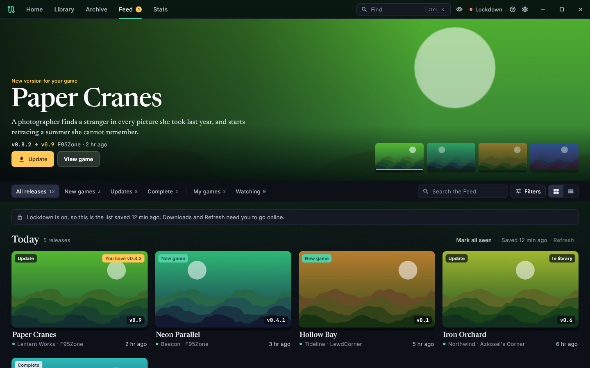
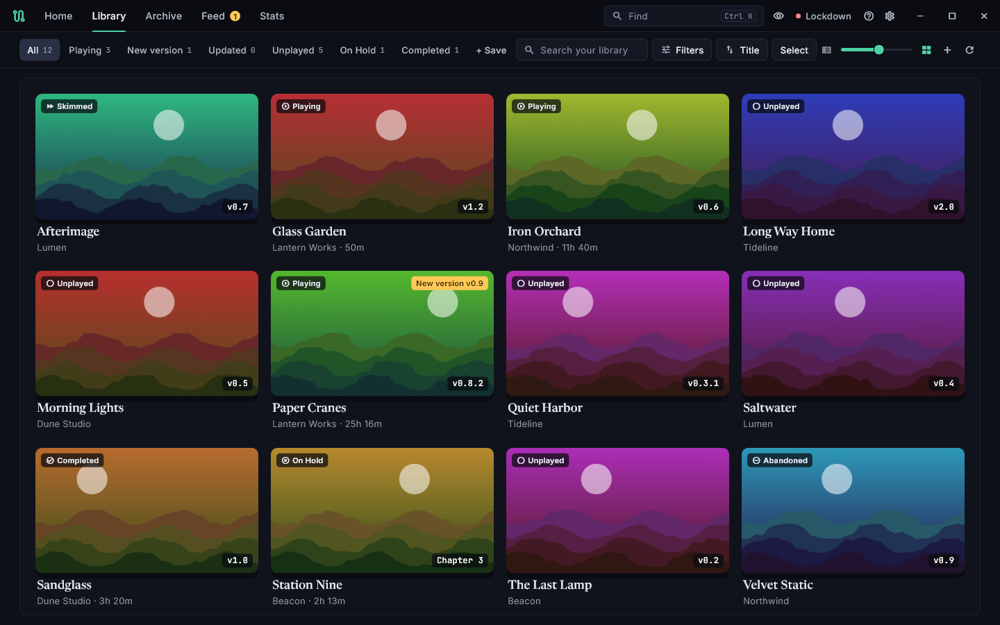
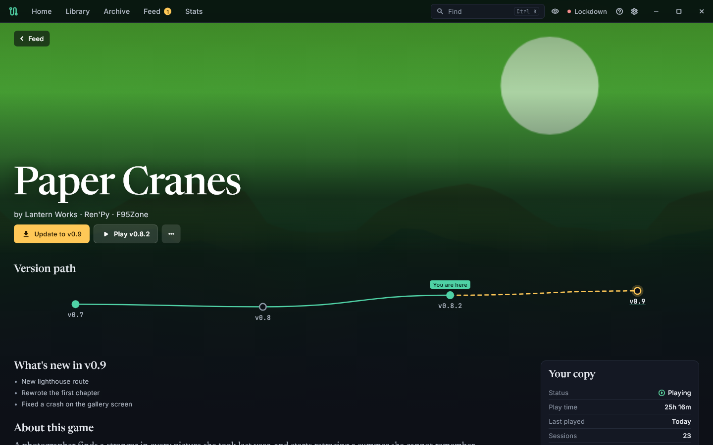
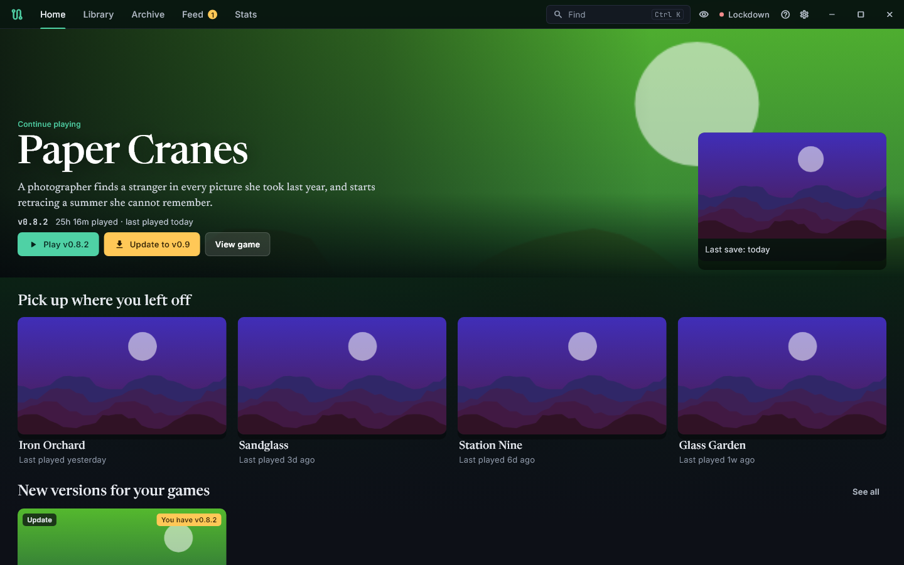
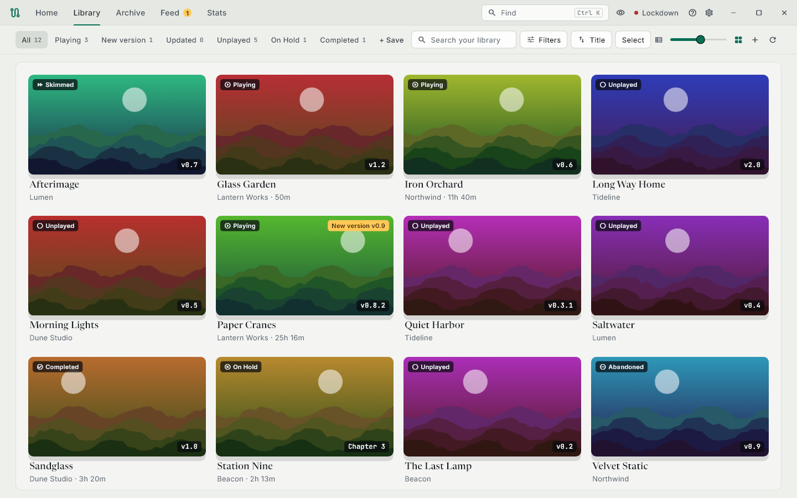

<div align="center">

# VN Pathfinder

**Your visual novel library, organised.** Every version of every game in one place, covers and details from the forums, update alerts, and downloads straight into your library.

[](https://github.com/NikoCloud/vn-pathfinder-flutter/releases/latest)
[](https://github.com/NikoCloud/vn-pathfinder-flutter/releases)
[](https://github.com/NikoCloud/vn-pathfinder-flutter/releases/latest)
<br>
[](https://flutter.dev)
[](LICENSE)
[](#privacy)



</div>

> **Release status:** VN Pathfinder 2.0 is in beta. Download it from [Releases](https://github.com/NikoCloud/vn-pathfinder-flutter/releases). Expect rough edges, and please [report them](https://github.com/NikoCloud/vn-pathfinder-flutter/issues).

## Screenshots

<table>
  <tr>
    <td width="50%"><br><sub><b>Library.</b> Every game with its art, status and version, and quick views along the top.</sub></td>
    <td width="50%"><br><sub><b>Game page.</b> The version path shows where you are and what's new since.</sub></td>
  </tr>
  <tr>
    <td width="50%"><br><sub><b>Home.</b> Continue playing from your last save, and pick up your other recent games.</sub></td>
    <td width="50%"><br><sub><b>Paperback.</b> The light theme, for daytime.</sub></td>
  </tr>
</table>

<sub>The games in these screenshots are made up, with placeholder art.</sub>

## Features

### Library

- Finds Ren'Py games and other Windows games in your library folders. Add as many folders as you like, on any drive, in **Settings → General**. Versions of one game in different folders show as one game
- Each folder shows how much room its drive has left. Downloads go to the first folder, and you drag the folders to choose which one that is
- A folder on a drive that isn't plugged in is skipped, and its games come back when it is. Nothing you've saved about them is lost
- Groups every installed version of a game under one entry
- Merge two entries that are really one game: right-click a game and choose **Merge into Another Game**. Likely matches are listed first, and your files aren't moved. When Pathfinder spots a likely duplicate, the game's page offers the merge
- Wide cover cards in a framed wall, or a list beside the game's page. One slider in the top bar sets the card size, and dragging it to the left end switches to the list
- Hovering a card lifts it and shows its tags, Play or Update, and more actions
- Quick views for Playing, New version, Updated, Unplayed, On Hold and Completed, plus views you save yourself
- Search by title or creator
- Filter by tags, engine, status, rating, recent release, available updates or Unfetched, and show hidden games
- Select several games to fetch metadata, set a status or hide them
- Drag the divider beside the game list to resize it. Double-click it to reset
- **Ctrl+K** finds any game, in your library or on the Feed
- Sort by title, developer, rating, recently played, play time or date added
- Tracks playtime, play count and last played
- The **Stats** tab shows your totals, play time by week, most-played games and top developers. The weekly chart starts from the sessions you play from this version on
- Add your own notes, cover art and tags, with built-in presets and your own
- Reorder, add and remove gallery images in **Properties → Art**
- Set launch options for each game
- Keyboard shortcuts for moving through the list, playing a game and browsing images. Press **F1** for the shortcuts and in-app help
- Minimize to the system tray (**Settings → General**)
- Midnight (dark), Paperback (light) and System themes, with your choice of accent color and text size
- **Discreet** blurs all art, including save previews. Press **Ctrl+Shift+D** or use the eye in the title bar
- Automatic backups of your user data

### Home

- Picks up where you left off: your last game, its last save, and your other recent games
- New versions for your games, new releases on the Feed, and what's ready to play

### Game page

Every game has one page, whether you own it or found it on the Feed.

- Art, developer, and Play, Update or Download
- A version path from what you have to the latest, with what changed in each version when the thread lists it
- Screenshots, tags and notes
- Your status, play time and sessions, plus patches and properties

### Game status

Every game gets a status automatically, based on its save files and play history:

| Status | Meaning |
|--------|---------|
| **Unplayed** | No saves or tracked playtime |
| **Playing** | You've played it |
| **Updated** | A newer version is installed than the one you played |
| **Skimmed** | Only autosaves, with no manual saves or quicksaves |

Set a status yourself under **Your copy** on a game's page, or from the right-click menu. You can also pick **On Hold**, **Completed** or **Abandoned**. Choosing **Auto** hands the game back to detection.

### Update alerts

- A badge marks games with a newer version on F95Zone
- Update takes you straight to the download
- A filter shows only games with an update
- Checks run when your library loads and while the app stays open, at most once every 6 hours
- An Update button in the title bar tells you when a new version of VN Pathfinder is out, and installs it (see [Updating](#updating))

Games are matched by forum thread, using the link saved by Fetch Metadata. Games without a link are matched by exact title. LewdCorner and Azkosel's Corner updates are picked up from the Feed for games with a saved link to that forum.

### Metadata

- Fetch details and images from **VNDB**, **F95Zone**, **LewdCorner**, **itch.io** and **Azkosel's Corner**
- Take each field from a different source in one step
- Click any image to make it the cover, or remove the ones you don't want
- Saves ratings from F95Zone and VNDB. F95Zone ratings refresh in the background, a few games at a time
- Failed searches are retried once on their own
- Log in to the forums through the built-in browser, including sites behind Cloudflare
- The **Unfetched** filter shows games with no saved metadata yet

### Archives and mods

- Browse the ZIP, RAR, RPA and RPY files in your library folders
- Downloads from the Feed and files that match a game you have show as cards with their art. Anything else is a plain row
- Extract ZIP and RAR archives from inside the app, with real speed and time left, and cancel at any point. Files are written as they unpack, so a large game doesn't have to fit in memory
- If an extraction fails, Archive tells you why
- Run several extractions at once (**Settings → Archives**)
- Extracted games are named from the best of the archive's name and the folder inside it
- **Clean Up** lists the archives whose version is already in your library, with the space they'd free, so you can delete the ones you pick
- Delete a game's archives from its right-click menu
- **Assign** makes a file a patch for a game, with a search box and a guess at the game. It can also give a file saved game data, for example after you rename a download
- **Keep the original** in Assign copies the file instead of moving it, so one mod can go to several games
- Mods with their own folders and images stay whole
- Turn mods on and off without deleting them, separately for each game version
- If a mod's name is already taken, you choose the new name
- Find leftover files and folders with the **Orphans** button
- **Downloads** at the top of Archive lists this session's downloads, finished and failed included, until you clear them

### Feed

- New releases and updates from **F95Zone**, **LewdCorner** and **Azkosel's Corner**, in time order, with the same card for every site
- A release is a new version of a game, not a new date. Replies and small edits don't send an old release back to the top
- A Spotlight leads with new versions of your games, then new games
- Shelves for new games, updates, complete games, your games and the games you're watching
- Every card shows how long ago the release went out, with the exact date and time on hover
- Search, and filter by site or by tags
- Watch a game to follow it before you install it, or mute it
- LewdCorner gives the most detail when you're logged in, and labels its Plus games, which need a forum role. Logged out, you get its public Games and AI Games feeds
- When several sites post the same version, the first one published gets the row. A different version keeps its own
- Refreshes every 6 hours, or every 12 or 24, or only when you ask
- After time away it reads each site back to where it left off, up to 10 days, a page at a time with a pause between pages. New cards appear as each page lands
- Azkosel's Corner has no release list, so its cards appear a few at a time while the app opens each new version's thread for its real date. The first refresh takes a few minutes
- Tells you when a site's full list didn't answer, when a site stopped answering partway back, or when a site couldn't be reached, keeps what it already had, and picks up on the next refresh
- Images are kept on your PC, so under Lockdown you still see what was already fetched

### Getting games

- Download or Update from a card or a game's page
- Pick the site, platform and file host, and the site's own page opens in the app, exactly as it is on the site, with any check, wait or ad. You finish it there
- The file lands in your first library folder, then Pathfinder extracts it, adds it to your library and shows it as ready to play. ZIP and RAR archives are extracted for you; anything else stays in the folder for you to handle
- The game arrives already fetched: its cover, screenshots, description, tags and thread link come with it, and update alerts work from the start
- For an update, keep the old version or remove it
- **Download a Version…** in a game page's ⋯ menu gets any version of a game you have, even when no update is detected
- If a connection drops, the download retries by itself and shows which try it's on. It picks up where it stopped if the host allows that, and otherwise starts again. If it gives up, it tells you why

## Requirements

- Windows 10 or 11, 64-bit (developed and tested on Windows 11)
- [Microsoft Edge WebView2 Runtime](https://developer.microsoft.com/microsoft-edge/webview2/) for forum logins and fetching (included with Windows 11)
- [7-Zip](https://www.7-zip.org/) to extract RAR archives

## Install

1. From the [latest release](https://github.com/NikoCloud/vn-pathfinder-flutter/releases), download `VN-Pathfinder-<version>-windows-setup.exe`. There's also a portable ZIP that runs from any folder without installing.
2. Run the installer. Releases aren't code-signed, so Windows may show **Windows protected your PC**. Click **More info**, then **Run anyway**. Your browser may also warn about the download. Each release lists the SHA-256 checksum of its files if you want to check your copy.
3. It installs for your Windows account only and doesn't need admin rights, unless you choose to install for everyone.

### Updating

When a new version is out, an **Update** button appears in the title bar. It shows what's new, and **Update now** downloads the installer, checks it against the checksum GitHub publishes, installs it and reopens the app. Your library, settings and games aren't touched. **Settings → About** has **Check for updates** to look on demand.

The portable version can't update itself: its Update button shows what's new and links to the release page for the new ZIP.

## Getting started

1. The first time you open the app, a short tour shows you around with made-up games. They're never saved and disappear when it ends. Take it again from **Help** (F1).
1. Open **Settings → General** and choose your library folder. Games in more than one place? Add each folder.
2. Lockdown Mode is on by default, so the app stays offline. To use online features, turn it off in **Settings → Network**.
3. In **Settings → Network**, log in to the forums you use.
4. Select a game and choose **Fetch Metadata**.

Update alerts and ratings start on their own once Lockdown Mode is off.

## Privacy

- **Offline by default.** Nothing goes online until you turn off Lockdown Mode.
- **No accounts, telemetry or analytics.**
- **Your data stays on your PC.** App data is in `%APPDATA%\VN Pathfinder\`, and each game's metadata and images are in a `.vnpf` folder inside the game. All fonts ship with the app, so nothing is fetched just to draw text.
- **The app only contacts the services you use.** Fetch Metadata, the Feed and game pages contact the sites you've chosen. Update checks send F95Zone the forum thread IDs of your games, plus title searches for games without a saved link and, a few at a time, to refresh ratings. To stop that, turn off Game Update Checks. Update Checks asks GitHub for the list of VN Pathfinder releases when the app starts. To stop that, turn off Update Checks. Updates are only downloaded when you choose Update now.
- **Stored without encryption.** Forum sessions are kept on your PC as plain files.

## Known issues

- LewdCorner Plus and AI+ games need a forum role. Without it, LewdCorner hides their images, and Fetch Metadata tells you so.
- LewdCorner no longer serves the full-size files of many older attachments. When that happens, Pathfinder uses another source for the same game if it can confirm a match, and otherwise saves small thumbnails and tells you.
- Update checks ask F95Zone directly. LewdCorner and Azkosel's Corner updates only show up through the Feed.
- With a library on a network share, a server that saves new files without permission to run them stops games from launching, and Windows says access is denied. The fix is on the server: let new files be executable.
- With the MEGA desktop app installed, MEGA links download through that app, so Pathfinder can't follow them. Save the file to your library folder and it shows up in Archive, with its art if you already have the game. A game you don't have yet arrives as a plain row, without its cover or screenshots.
- On LewdCorner and Azkosel's Corner, a fix released under the same version number doesn't come back up the Feed.
- The first time the Feed sees a LewdCorner thread it has no history for it, so a small edit can pass as that release's date once.
- Logged out of F95Zone or LewdCorner, the public feeds only know a thread's latest reply, so an old thread can show as recent the first time it's seen.
- Games that have a `.vnpf` folder from Game Properties or Add Game don't count as Unfetched, even if nothing was fetched.
- Only the folders directly inside each library folder are looked at. A game inside another folder, such as `Library\Ren'Py\Game`, isn't found yet. Add each inner folder (`Library\Ren'Py`) as a library folder instead of the folder above it.
- Windows only for now. macOS and Linux need a different built-in browser.
- Windows 11's Snap Layouts menu doesn't appear when you hover the maximize button. Dragging a window to a screen edge and Win+Z still work.

## Roadmap

Planned, in no fixed order:

- Discord channels in the Feed
- A backup metadata service for when sources are down
- A staging folder on a fast drive, so you can play a game right away while it moves to storage in the background
- macOS and Linux versions, planned for the first release candidate
- Mod manager integration and community mod sharing
- Translations
- iOS and Android, after 2.0

The full list is in the [feature backlog](docs/dev/BACKLOG.md).

## Build from source

You'll need:

- [Flutter](https://flutter.dev/docs/get-started/install) 3.41.6
- Visual Studio 2022 with the **Desktop development with C++** workload
- Windows Developer Mode turned on

```bash
git clone https://github.com/NikoCloud/vn-pathfinder-flutter.git
cd vn-pathfinder-flutter
flutter pub get
flutter build windows --release
```

The app is built to `build\windows\x64\runner\Release\vn_pathfinder.exe`.

To package it, run `powershell -File tool\package_windows.ps1`. That builds the app and puts a portable ZIP in `dist\`, plus an installer if [Inno Setup 6](https://jrsoftware.org/isinfo.php) is installed.

Run the tests with `flutter test`. Developer notes are in [docs/dev](docs/dev).

## Feedback

Found a bug or have an idea? [Open an issue](https://github.com/NikoCloud/vn-pathfinder-flutter/issues).

## License

Apache License 2.0. See [LICENSE](LICENSE).
